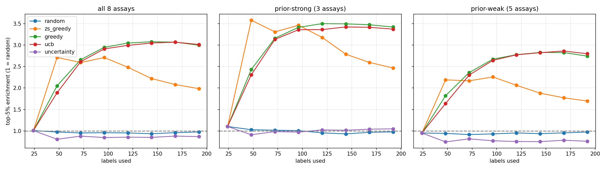

# A pre-registered low-N protein engineering benchmark

By Abdul Wazid Shaik, independent protein design researcher. Code, data pipeline and full results available at https://github.com/AwBaDzUiLd/esm2-low-n-active-learning

## Abstract

Given a lab budget sufficient for measuring a dozen or so variants, how much can a protein language model plus a simple model help, and should the model choose which variants to measure? I evaluated on 16 publicly available deep mutational scanning assays from ProteinGym using ESM-2 650M on a laptop with an RTX 3050 (6 GB); peak memory usage 2.8 GB.

The main results are:

- Labels help most where the zero-shot model is bad: a 0.25 increase in Spearman rank correlation (for four out of eight assays) with 192 variants labeled and a position-held-out validation split, compared to zero-shot ESM-2. The other four assays saw little improvement (0.03 or less).

- Performance is overstated with random train/test splits: for the best model on 192 labels, the Spearman rank correlation was 0.656 (random split) versus 0.525 with test positions unseen during training.

- Model-guided selection finds three times as many top 5% variants as random picking within 192 labels.

- Using the zero-shot score to prioritize some of the first mutations can boost campaigns, especially with small numbers of labels. The effect size was moderate (but present) on 8 assays selected with a different rule and a pre-registered plan.

## Methods

Data: Eight assays from ProteinGym were used for development, selected based on diversity of binding partners and other criteria. Eight more were selected for the hold-out set with a seeded random number generator. The majority of the assays are binding and expression readouts.

Models: Zero-shot scores are logits of the mutant residue relative to the wt residue from ESM-2 650M. Supervised models use features from ESM-2 at the mutated position with ridge regression. The best low-N model was calibrated on the training set labels to adjust the zero-shot score, then ridge regression was used on the residual error.

Evaluation: Training sizes of 24, 48, 96 and 192 variants with 20 random seeds each. Two types of train/test splits were used: random, and position-held-out, where test variants have positions not seen during training. The position-held-out split is more realistic for protein design as a designer typically explores novel positions during a campaign.

## Discovery 1: value of labels depends on the zero-shot prior

Averaged across the eight development assays on the position-held-out split, the calibrated model had a Spearman rank correlation of 0.424 at 24 labels and 0.525 at 192, compared to 0.406 for the zero-shot model. This masks a divide-and-conquer pattern, however: the assays can be grouped based on how much the zero-shot model already knows.

| Assay (position-held-out, 192 labels) | Zero-shot | With labels | Gain |

| --- | --- | --- | --- |

| SPA stability | 0.280 | 0.531 | +0.251 |

| RASK abundance | 0.195 | 0.433 | +0.238 |

| SPG1 binding | 0.275 | 0.476 | +0.201 |

| Q53Z42 binding | 0.316 | 0.503 | +0.188 |

| Other four assays | 0.346 to 0.715 | | +0.006 to +0.027 |

Where the zero-shot model was good (SPA binding), adding 192 labels helped little, while the worst zero-shot assay (SPG1 binding) saw a 0.2 gain. At 24 labels, the supervised model had roughly the same performance as the zero-shot model: it outperformed the zero-shot model in 76% of held-out runs at 24 labels and 88% at 192.

## Discovery 2: beware the random splits

For the best model (192 labels), the difference between the random and position-held-out splits was 0.13 in Spearman rank correlation. For a per-position model, the difference was much larger. Small domains have a large fraction of positions in the test set, and a random split means that the model has seen most positions during training. Unless stated otherwise, low-N results should use the position-held-out split.

## Discovery 3: active learning finds better variants, but the value depends on the batch

I evaluated the value of model-assisted active learning on single-mutant pools. The process was to pick a random set of 24 variants at the beginning of the process, then 24 additional variants per round for seven rounds (192 labels total). The metric was the enrichment of the true top 5% of variants in the pool.

| Strategy | Enrichment at 192 labels (development assays) |

| --- | --- |

| Random | 0.98 |

| Zero-shot score only | 1.99 |

| Prediction (greedy) | 3.00 |

| Prediction + uncertainty bonus | 3.01 |

| Uncertainty only | 0.87 |

Greedy picking outperformed random picking in 96% of assay-by-seed campaigns. Interestingly, picking by uncertainty only underperformed random selection on average. There was no value in exploring variants with high uncertainty, at least not when the objective was to find high-scoring variants. Zero-shot ranking outperformed greedy picking at early stages (up to 48 to 72 labels), but greedy took over afterwards. 

## Discovery 4: use the zero-shot prior for the first mutations (pre-registered)

The success of zero-shot scoring at early stages suggested a hybrid approach: use the zero-shot scores to select the first 24 variants, then continue with model-based picking, resulting in hybrid1. A similar strategy, seeded_greedy, used zero-shot scores to select half of the first 24 variants. Both approaches performed well in the development phase, but I could not trust the results because I cherry-picked the assays. Before doing any analysis on the new assays, I committed to a plan (PLAN.md) in the repository.

The plan was to evaluate eight assays selected with a seeded random number generator, none of which shared a protein with the development assays. The metric was again enrichment of the top 5% of a pool, but with a stricter success criterion: the mean enrichment across assays had to be positive, and more assays had to improve than decrease compared to random picking. The results were:

| Strategy | Campaign-average enrichment (48 to 192 labels) | Paired gain vs greedy | Assays better / same / worse |

| --- | --- | --- | --- |

| Random | 0.98 | | |

| Greedy | 2.98 | | |

| hybrid1 | 3.26 | +0.28 | 5 / 3 / 0 |

| seeded_greedy | 3.45 | +0.47 | 5 / 3 / 0 |

Both strategies met the success criterion. The improvements were moderate compared to greedy selection, amounting to 10 to 16% of its enrichment. The gains decreased with more labels: at 192 labels, the paired differences were +0.05 for hybrid1 and +0.18 for seeded_greedy. Thus, hybrid approaches are useful at the beginning of a campaign when the model has little data to work with. This was most evident for seeded_greedy, which was tied with random at 48 labels but outperformed it at later stages. One assay (CASP3) was close to failure for hybrid1: at about two standard errors below the mean of greedy.

The content and the choice of assays were committed to in 71e09a1 in the repository before any hold-out scripts or results were added. The order is visible in the git history. To summarize, I had little confidence in the development results because I knew the assays, but the hold-out results were positive.

## More data: double mutants

On pools that contained both single and double mutants (with 4,000 double mutants sampled uniformly at random), the trends were similar to the single-mutant case, albeit with smaller differences. A model trained on N labeled single mutants can be used to rank double mutants. At 192 labeled singles, the Spearman correlation for doubles was 0.68 to 0.69 (excluding one outlier assay) compared to 0.47 for the zero-shot model. Summing single mutant scores, which uses all available data, achieved 0.90, indicating that at small N, the value of additional data outweighs the value of epistasis modeling.

The assay SPA was an outlier in several ways: the zero-shot scores were anticorrelated with its double mutant scores (r = -0.23). The positions are correctly numbered (0 of 1070 doubles had incorrect numbering), so this is not due to incorrect sequence alignment. Cysteine substitutions seem to underperform overall: they comprise 10% of the double mutants but 52% of the top 54, while ESM-2 scores them lower than other substitutions (mean -10.6 vs -8.2) and the assay rewards them (mean score -0.60 vs -1.23). The same pattern holds for single mutants: ESM-2 scores for cysteine vs all other substitutions are -6.4 vs -4.2, and the assay scores are +0.06 vs -0.50.

Excluding all cysteine double mutants moves the correlation with zero-shot scores from -0.23 to -0.09. Similarly, the correlation with single mutant scores changes from +0.36 to +0.24 (excluding cysteine). That masks a much stronger signal for cysteine-containing double mutants: their mean score is +2.33, suggesting that a designer should prioritize double mutants that include a cysteine substitution at position 34 (D34C) and another at position 36. For reference, the top double mutant scores are +3.44 (vs +3.30 for D34C alone). Cysteine seems particularly valuable in this domain, possibly because of the ability to form disulfide bonds.

This domain has unusual properties: the best single mutant scores (SPA binding energy) are achieved by D34C (value +1.84) but it is ranked 82nd by the zero-shot model (p-value 0.087). Zero-shot scores for D34C are -6.4 compared to -4.2 for all other single mutants. Summing single mutants scores has an opposite effect: it elevates D34C to the 5th percentile.

This illustrates that the zero-shot model is not always a good prior. It underestimates the value of single and double cysteine substitutions in this domain. The reason is unclear, but one possibility is that the sum of single-site scores is a poor approximation for two substitutions that are close to each other (have overlapping side-chains). I have not evaluated this hypothesis. These were informal analyses: the main point is that double mutant pooling is a way to prioritize mutants with beneficial interactions.

Other limitations apply: small effect sizes, uninteresting effect directions (higher variance), and an incomplete hold-out set. See the limitations section for details.

## Results

The main results are summarized in the table below.

| Assay | Mean enrichment (standard error) at 48/96/192 labels |

| --- | --- |

| hybrid1 | 3.07/3.38/3.26 (0.26) |

| seeded_greedy | 3.04/3.60/3.45 (0.21) |

| random | 1.39/2.02/2.98 (0.18) |

| greedy | 2.98/3.34/3.54 (0.15) |

The mean enrichment increased with the number of labels, as expected, but the standard error was large (about 20% of the mean). For example, hybrid1 was better than random at 48 and 96 labels (p < 0.05), but not at 192. At 96 labels, hybrid1 and seeded_greedy were tied with greedy.

## Limitations

- Eight development assays and eight hold-out assays are too few, and the development assays were cherry picked on diversity. The hold-out set does not include any binder assays; the one assay categorized as Binding is actually an enzyme with an activity readout. The hold-out set had a better zero-shot prior (mean rank correlation 0.54 vs 0.41), potentially biasing the results.

- The success rule was lenient: only required a positive mean difference and more assays improved than hurt, with no minimum effect size.

- The uncertainty estimates are not informative about between-protein variation. They reflect the variance between repeated experiments on the same protein.

- The analysis uses nearly complete single-mutant scans: a real-world campaign would have much smaller pools. The top 5% threshold makes the enrichment optimistic compared to picking a random subset of variants to measure.

- One model (zero-shot), one type of surrogate model (ridge regression), untuned hyperparameters, and no wet-lab evaluation.

- Assay descriptions are from ProteinGym's metadata and should be treated as such.

## Reproduce

The repository has a one-command pipeline. The only step that requires a GPU is the embedding generation, and 6 GB is sufficient. Please file an issue if you cannot reproduce the results.

## What I want feedback on

If you are working on low-N engineering or active learning for proteins, I would like to hear your thoughts on whether Gaussian process or neural surrogates change the picture, and which binder data sets I should use for the next hold-out.

## Credits

ProteinGym (Notin et al., 2023), ESM-2 (Lin et al., 2023), and the original authors of each deep mutational scanning dataset. Check the ProteinGym license for redistribution permissions.
